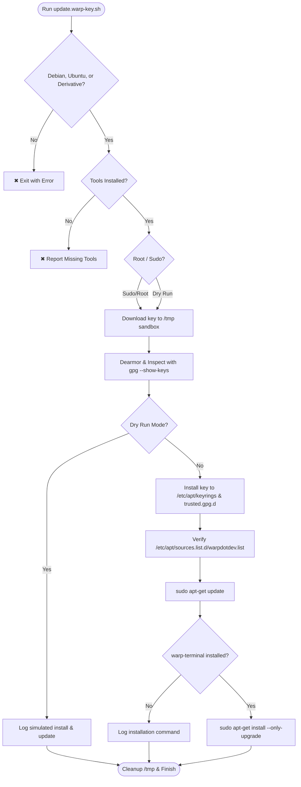

<div align="center">

# 🔑 Warp Terminal GPG Key Rotation & Update Utility

**Automated, safe, and robust GPG repository key management for Warp Terminal on Debian, Ubuntu, and derivatives.**

[](#-prerequisites)
[](#-prerequisites)
[](#-version-history)
[](#-workflow)

<br/>

</div>

---

## 📖 Overview

When [Warp Terminal](https://www.warp.dev) rotates or revokes its APT repository GPG signing subkeys, standard `apt update` calls on Debian, Ubuntu, and downstream distros fail with verification errors such as:

```text
The following signatures couldn't be verified because the public key is not available: NO_PUBKEY ...
```
or
```text
An error occurred during the signature verification. The repository is not updated...
```

`update.warp-key.sh` completely automates the resolution process: it validates your OS, securely stages and inspects the new official key from Warp, installs it to both modern and legacy APT keyring locations with safe permissions, refreshes the APT index, and optionally updates `warp-terminal`.

---

## ✨ Features

- 🐧 **Debian & Ubuntu Ecosystem Support**: Inspects `/etc/os-release` to verify Debian, Ubuntu, or derivative distributions (Linux Mint, Zorin OS, Pop!_OS, elementary OS, Kali, LMDE, etc.).
- 🛡️ **Atomic & Safe Staging**: Fetches keys directly into a temporary sandbox directory with `curl` retries and timeouts—never pipes raw downloads directly into system keyrings.
- 🔍 **Cryptographic Validation**: Validates the OpenPGP public key block, dearmors to binary format, and displays fingerprints and expiration dates via `gpg --show-keys`.
- 📁 **Dual Keyring Compatibility**:
  - Installs to `/etc/apt/keyrings/warpdotdev.gpg` (modern Debian standard with `0644` permissions).
  - Installs to `/etc/apt/trusted.gpg.d/warpdotdev.gpg` (retains compatibility with official `.deb` package installer configurations).
- 📐 **Dynamic Architecture Detection**: Automatically detects system architecture (`amd64`, `arm64`) via `dpkg --print-architecture` when creating repository entries.
- 🧪 **Dry-Run Mode (`-d` / `--dry-run`)**: Simulates the entire process (fetches and validates the real key in staging) without touching system files or packages.
- 🎨 **Informative Terminal Output**: Clean ANSI colors, step headers, and Unicode status badges (`✔`, `✖`, `ℹ`, `⚠`, `➜`, `🔑`, `📦`) with automatic fallback for `NO_COLOR` and non-TTY environments.
- 🧹 **Robust Signal Trapping**: Uses `trap` on `EXIT`, `INT` (Ctrl+C), and `TERM` to guarantee temporary files are wiped even if interrupted.

---

## 📋 Prerequisites

The script requires standard Linux core utilities available on APT-based distributions:
- **Operating Systems**:
  - **Debian**: Debian GNU/Linux (`Trixie`, `Forky`, `SID`, `Bookworm`, etc.)
  - **Ubuntu**: Ubuntu LTS & interim releases (`Noble 24.04`, `Jammy 22.04`, `Plucky 25.04`, etc.)
  - **Derivatives & Alternatives**: Linux Mint, Zorin OS, Pop!_OS, elementary OS, LMDE, Kali Linux, Devuan, Parrot, Tuxedo OS, etc.
- **Packages**: `bash`, `curl`, `gpg`, `apt-get`, `coreutils` (`install`, `chmod`), and `sudo` (if not running as `root`).

---

## 🚀 Quick Start

### 1. Download & Make Executable

```bash
chmod +x update.warp-key.sh
```

### 2. Run the Script

```bash
# Standard key update and warp-terminal upgrade
./update.warp-key.sh
```

### 3. Run in Dry-Run Mode (Safe Test)

```bash
# Simulates actions and verifies the key without writing to disk
./update.warp-key.sh -d
```

---

## ⚙️ Command-Line Options

| Flag | Long Flag | Description |
| :--- | :--- | :--- |
| `-h` | `--help` | Display syntax, actions list, and usage examples. |
| `-v` | `--version` | Display script version and changelog table. |
| `-d` | `--dry-run` | Test run: downloads and verifies key in staging; skips disk writes and upgrades. |
| `-s` | `--skip-upgrade` | Update keys and refresh APT cache only; skip package upgrade step. |

---

## 🔄 Workflow



---

## 🏷️ Version History

| Version | Date | Comments |
| :---: | :---: | :--- |
| **`v0.2`** | 2026-11-06 | Added full support for Ubuntu and derivative distros (Linux Mint, Zorin OS, Pop!_OS, elementary OS, Kali, LMDE, etc.), dry-run mode (`-d` / `--dry-run`), dynamic architecture detection (`dpkg --print-architecture`), non-interactive APT parameters, enhanced error trapping, and version table flag (`-v`). |
| **`v0.1`** | 2026-11-06 | Initial release with Debian OS verification, prerequisites check, staging download, GPG validation, dual keyring support, color logging, and help documentation (`-h`). |

---

## 💡 Troubleshooting

### Sudo Prompt Times Out
The script invokes `sudo -v` at the start to authenticate credentials before running. If you encounter sudo errors, ensure your user is in the `sudo` group:
```bash
groups
```

### Manual Key Fingerprint Check
You can inspect the newly installed GPG key at any time using:
```bash
gpg --show-keys /etc/apt/keyrings/warpdotdev.gpg
```
Expected signing key details:
- **UID**: `Warp Linux Maintainers (Package Signing Authority) <linux-maintainers@warp.dev>`
- **Key ID**: `0913165C78D5B7A41B42AC657FF7AB39D60F803F`
- **Subkey**: `rsa4096 2026-10-30 [S] [expires: 2028-10-29]`

---

## 📄 License

Distributed under the [MIT License](https://opensource.org/licenses/MIT).
